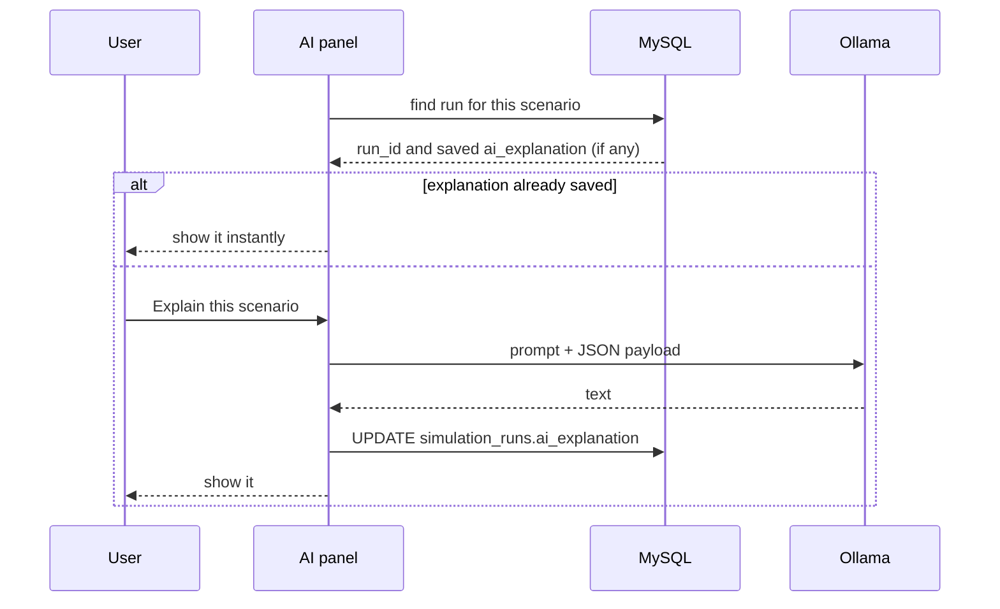

# AI Assistant

The application uses a **local** language model (Phi-3 through Ollama) for exactly two jobs. It never calculates, and no data leaves the machine.

| Job | Function | Input | Output |
|---|---|---|---|
| Explain a result | `ask_ollama` | JSON payload of computed results | Executive text, four sections |
| Read a free-text scenario | `parse_free_type_scenario_with_ollama` | A sentence | Numeric driver values |

## Guardrails

| Guardrail | How |
|---|---|
| Python owns every number | The prompt says: *do NOT change, invent, or calculate new numerical values* |
| Explanation is read-only | The model receives results and returns text; nothing is fed back into the engine |
| Deterministic output | Temperature is `OLLAMA_TEMPERATURE` (default 0.0) for explanations and 0 for parsing |
| Parsing is shown before use | Extracted values are displayed in a table and clamped by the UI before running |
| Graceful failure | If Ollama is down or the model is missing, a message is shown and regex parsing takes over |
| Local only | Default endpoint `http://localhost:11434` |

## Explanation flow

### Prompt

The system role is a *Senior ALM Analyst at NBE*. The model must return four sections: Executive Summary, Key Financial Drivers, Risk & Liquidity Impact, Strategic ALCO Recommendations. It is told to base everything strictly on the JSON.

### Payload sent to the model

| Field | Content |
|---|---|
| Identity | Scenario name, type, simulation date, horizon |
| `inputs` | The nine driver values |
| `before`, `after` | All KPI dictionaries (macro fields removed) |
| `risk`, `overall_risk` | Risk summary rows and the overall level |
| `deterministic_insights` | The rule-based sentences |

Saved explanations are loaded from the database the next time the same scenario is opened, so the model is called once per run.

## Free-text parsing

1. If Ollama is running and the model is installed, Phi-3 is asked for JSON with the nine keys (`format: json`).
2. Values go through `clean_numeric_value`, which understands `bps` (divides by 100).
3. A regex parser (English and Arabic) fills any key the model left empty.
4. The result records its source, `phi3` or `regex_fallback`.

## Configuration

Set in **Data & Settings → AI (Ollama)** or through `OLLAMA_HOST`, `OLLAMA_MODEL`, `OLLAMA_TIMEOUT` (default 800 s) and `OLLAMA_TEMPERATURE`. Any Ollama model name can be used, though the prompt was written for Phi-3.

## Choosing the model

| Option | Trade-off |
|---|---|
| Phi-3 (current) | Small, runs on a laptop, keeps data local; weaker prose and occasional drift from the payload |
| Larger local model | Better narrative, needs more memory |
| Hosted model | Best quality, but requires approval to send bank data outside |

Because the model never produces numbers, swapping it changes only the wording quality, not the results.

## Reviewing AI text

AI explanations are drafts. Before circulation, an analyst should check that every figure quoted matches the KPI table, which is straightforward because the same payload is available on the dashboard.
