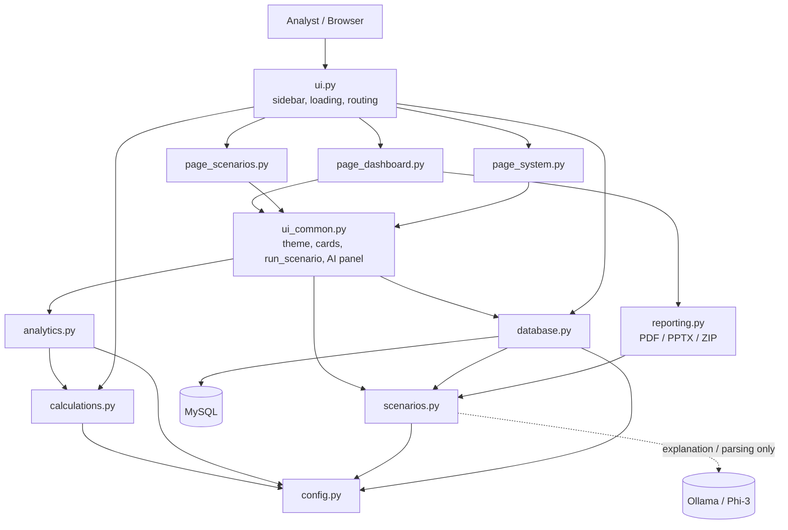
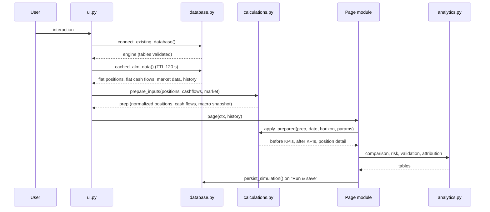
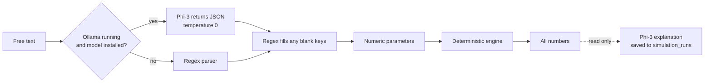

# Architecture

## Layered view

| Layer | Modules | Responsibility |
|---|---|---|
| Presentation | `ui.py`, `page_*.py`, `ui_common.py` | Screens, controls, charts, state |
| Domain logic | `calculations.py`, `analytics.py`, `scenarios.py` | Engine, KPIs, risk, validation, parameters |
| Reporting | `reporting.py`, Excel export in `analytics.py` | Documents and spreadsheets |
| Data access | `database.py` | Connection, reads, persistence |
| Configuration | `config.py` | Constants and thresholds |

`config` depends on nothing. `calculations` and `scenarios` depend only on `config`. There are no circular imports.

## Request lifecycle

Streamlit re-runs the script on every interaction. Each run does the following.

The shared context `ctx` (a `SimpleNamespace`) carries the engine, raw tables, the flat views, the prepared inputs, a data stamp used as a cache key, and the saved scenario history.

## Execution flow of a scenario

`run_scenario()` in `ui_common.py` is the single entry point used by every page:

1. `build_scenario_parameters` fills missing drivers with neutral defaults.
2. `apply_prepared` runs the position engine and the liquidity engine and returns `before`, `after` and the position-level `detail`.
3. `comparison_table`, `build_alm_risk_summary` and `overall_risk_rating` build the result tables.
4. `calculation_validation_table` recomputes the headline KPIs independently.

## State and caching

| Mechanism | What it holds |
|---|---|
| `st.session_state` | Connection settings, active template, scenario parameters, simulation date, horizon, AI text, report bytes |
| `st.cache_resource` | The SQLAlchemy engine, keyed by connection values |
| `st.cache_data` (120 s) | All loaded tables and views, plus driver attribution and sensitivity results |
| **Reload data** button | Clears the data cache |

## Local AI boundary

The model does two things only: it extracts explicit numbers from text, and it narrates results that Python already computed. See [AI Assistant](ai.md).

## Deployment shape

A single Streamlit process, one MySQL database and an optional local Ollama service. There is no application server, message queue or external API. This keeps data on the bank's own machines.
