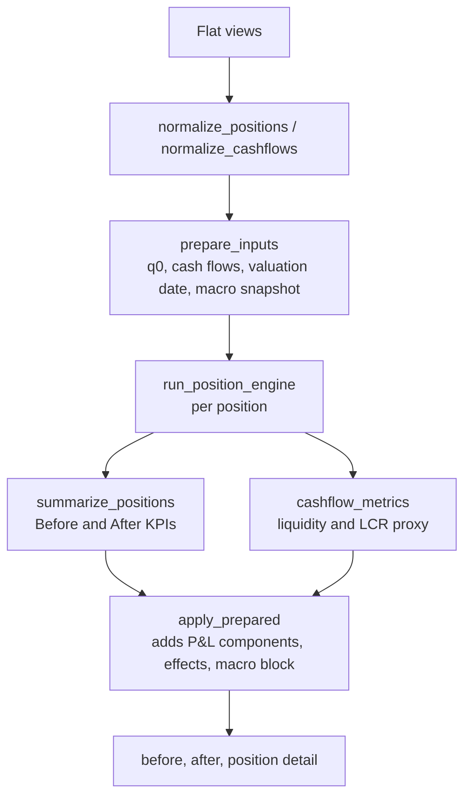

# Calculation Engine

All numbers in the application come from `calculations.py`. This page lists every formula in the order the engine applies it. Symbols: $b_0$ balance before, $b_1$ balance after, $r_0$ rate before, $r_1$ rate after, $D$ accrual days, $H$ horizon days, $t_1$ days from the simulation date to the first repricing event.

!!! info "Conventions"
    Rates are decimal fractions (0.12 = 12 %). Day count is actual/365 (`DAYS_PER_YEAR`). Amounts are EGP equivalents. Interest is accrued over the horizon, not annualised, unless a formula says so.

## Pipeline

`prepare_inputs` does the normalisation that does not depend on the scenario once per page run, and the resulting `prep` object is reused by every scenario evaluation on that run (the dashboard, sensitivity and attribution), so those repeated engine runs do not re-normalise the data.

## 1. Classification

| Rule | Detail |
|---|---|
| Active only | Positions whose `Status` is `Active` or blank |
| Category | `ALM_Position_Category` title-cased: Loan, Deposit, Investment, other |
| Funding | A Deposit whose segment is in `FUNDING_SEGMENTS` (`Treasury`) becomes **Funding** |
| Balance | `Evaluated_Balance_EGP`, or native balance × market rate when missing |
| Frequency days | Text such as *Monthly* is mapped by `FREQUENCY_WORD_DAYS` (30, 91, 182, 365...). Codes like `3M` use `TENOR_DAY_FACTORS` (M = 30.4375). *At Maturity*, *Spot*, *Open-ended* have no frequency |

## 2. Accrual window

$$h_{end} = sim + H$$

- A position is **matured** if its maturity date is on or before the simulation date. It is excluded (balance set to 0, days 0) because `EXCLUDE_MATURED_POSITIONS = True`.
- With `ROLLOVER_AT_MATURITY = True` every surviving position accrues for the whole horizon: $D = H$. A position maturing inside the window is assumed to roll over.

## 3. Repricing event

A position is **rate-eligible** when its rate type is not *fixed / non-interest / zero interest* and is floating-like, or when its category is loan, deposit, funding or investment. In practice almost every non-fixed position is eligible.

**First event date.**

- Take `Next_Repricing_Date`.
- If it is before the simulation date, roll it forward by whole frequency steps: $\lceil (sim - rep) / f \rceil$ days. If there is no frequency, use the simulation date.
- If the date is blank, the first event is the simulation date.

**Event exists** (`has_event`, shown as the **Eligible** column) when $D>0$ and either

- the position is eligible and its first event is before the end of the window, or
- it is *not* eligible (fixed) but **matures inside the window**, so it reprices at maturity.

$$t_1 = \min\big(\max(first - sim, 0),\ D\big)$$

| Output | Meaning |
|---|---|
| `Repricing Event Count` | 0 without an event; else the number of frequency steps after the first, rounded up, or 1 |
| `Repricing Fraction` | $(D - t_1)/D$, the share of the window spent at the new rate |

!!! warning "The column called *Eligible*"
    It means *has a repricing event inside the horizon*, not *is floating-rate*. This is the set used by the repricing gap.

## 4. Rate shock

Only a **parallel shock** exists.

$$\Delta r = \frac{rate\_change\_pp}{100}$$

$$r_1 = \begin{cases} \max(0,\ r_0 + \Delta r) & \text{if the position has an event} \\ r_0 & \text{otherwise} \end{cases}$$

The floor `RATE_FLOOR` is 0. There is no yield curve, no pass-through coefficient and no product-specific beta. `market_data` rates are **not** used to reprice.

**Time-weighted rate over the window**

$$\text{profile} = \frac{r_0 D + (r_1 - r_0)(D - t_1)}{365}$$

This equals $r_0 D/365$ until the first event, then $r_1$ afterwards.

## 5. Balances

$$g = \begin{cases} 1 + \dfrac{loan\_growth}{100} & \text{loans} \\[2mm] \left(1+\dfrac{deposit\_growth}{100}\right)\left(1-\dfrac{runoff}{100}\right) & \text{deposits (not Funding)} \\[2mm] 1 & \text{other} \end{cases} \qquad g \ge 0$$

$$s = 1 + \frac{shock\%}{100}\quad(\text{FX shock for FX positions, gold shock for gold, else }0)$$

$$b_1 = b_0 \cdot g \cdot s$$

Run-off and deposit growth apply to **Deposit** positions only; Treasury-segment deposits are Funding and are not run off.

## 6. Interest and its decomposition

$$I_{before} = b_0 \cdot \frac{r_0 D}{365}$$

$$I_{rate\text{-}only} = b_0 \cdot \text{profile}$$

$$I_{after} = b_1 \cdot \text{profile}$$

| Effect | Formula |
|---|---|
| Rate effect | $I_{rate\text{-}only} - I_{before}$ |
| Volume effect | $I_{after} - I_{rate\text{-}only}$ (growth, run-off and FX/gold shock) |
| Interest change | $I_{after} - I_{before}$ = rate + volume |

## 7. NII, NIM, cost of funds

$$NII = (\text{loan interest} + \text{investment interest}) - (\text{deposit interest} + \text{funding interest})$$

$$NIM\% = \frac{NII \cdot 365/H}{\text{Loans} + \text{Investments}} \times 100$$

$$CoF\% = \frac{\text{Interest expense} \cdot 365/H}{\text{Deposits} + \text{Funding}} \times 100$$

$$\text{Loan/Deposit \%} = \frac{\text{Loans}}{\text{Deposits}} \times 100$$

NIM and cost of funds are annualised; NII is for the horizon.

**Repricing gap**

$$\text{Gap} = \sum_{\text{loans, investments, has event}} b - \sum_{\text{deposits, funding, has event}} b$$

## 8. P&L and value components

| Component | Formula | Sign |
|---|---|---|
| ΔNII | $NII_{after} - NII_{before}$ | + or − |
| Credit cost | Loans: $b_1 \cdot c \cdot H/365$ with $c = \dfrac{25\cdot \max(\Delta unemp,0) + 20\cdot \max(-\Delta gdp,0)}{10000}$ | shown as negative |
| FX / gold revaluation | $sign \cdot b_0 \cdot g \cdot (s-1)$, sign +1 for loans and investments, −1 for deposits and funding | + or − |
| Investment MTM | $-\,dur \cdot \Delta r \cdot b_1$ for investments that are not gold, with $dur = \dfrac{\max(first-sim,0)}{365\,(1+r_0)}$ | + or − |

$$\text{Total} = \Delta NII - \text{credit cost} + \text{revaluation} + \text{MTM}$$

!!! note "Illustrative constants"
    The 25 bps (unemployment) and 20 bps (GDP) credit-cost sensitivities are fixed, transparent placeholders in `config.py`. They are not calibrated to the bank's loss history. Only an *increase* in unemployment and a *fall* in GDP create cost; favourable moves create no gain.

## 9. Liquidity metrics

`cashflow_metrics` runs twice: **before** with neutral parameters and **after** with the scenario.

| Metric | Definition |
|---|---|
| CF Inflow / Outflow | Cash flows dated from the simulation date to the horizon end, amounts shocked by FX or gold when the flow is in that basis |
| Run-off outflow | $\dfrac{runoff}{100} \times \sum (b_0 \cdot s)$ over deposits, **added to horizon outflow** |
| CF Net Cashflow | Inflow − outflow |
| CF HQLA | Balance of investments flagged HQLA |
| **CF LCR %** (headline) | $\dfrac{\text{HQLA}}{\text{Deposits}} \times 100$ with after-scenario balances |
| LCR Net Outflow | 30-day scheduled outflows + run-off + 15 % of (deposits + funding). Computed and exposed, **not** used in the headline |

!!! warning "The headline LCR is a proxy"
    The dashboard LCR is HQLA divided by deposits. It is not the Basel LCR (HQLA over 30-day net stressed outflows), and the risk rule compares it with a **100 %** threshold. Check the value on real data before presenting it. See [Limitations](limitations.md).

## 10. Macro block

The latest policy rate, inflation, unemployment and GDP observations are read from `market_data`, shown "before", and shown "after" as the observation plus the scenario shock. They feed the banner and the AI payload; apart from credit cost, they do not alter any KPI.

## Worked example

A loan of EGP 1,000,000 at 12 %, floating, repricing quarterly, next repricing in 30 days, horizon 365 days, rate shock +2 pp, no other drivers.

- $D = 365$, $t_1 = 30$, $r_1 = 14\%$
- profile $= (0.12 \cdot 365 + 0.02 \cdot 335)/365 = 0.13836$
- $I_{before} = 120{,}000$, $I_{after} = 138{,}356$
- Rate effect $= +18{,}356$, volume effect $= 0$
- Repricing fraction $= 335/365 = 91.8\%$

## Self-consistency

The validation table in [Analytics & Validation](analytics.md) recomputes NII, NIM, cost of funds, total P&L and LCR from the position detail and compares them with the reported values.
