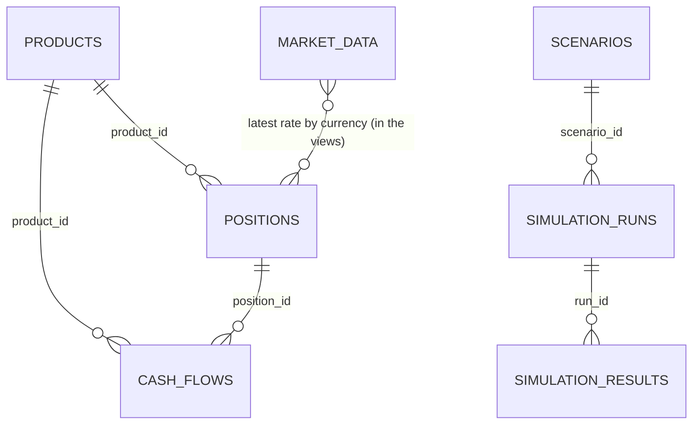
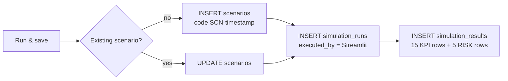

# Database

The application uses an **existing** MySQL 8 database named `nbe_alm_simulation`. `REQUIRED_TABLES` in `config.py` lists the seven tables, and `connect_existing_database()` stops with a clear message if any is missing. Table names are matched case-insensitively (`LOWER(table_name)`), so the code works on Windows and Linux servers alike.

!!! info "Source of this page"
    The tables and views below are taken from the project's current schema dump (`NBE_Data.sql`, InnoDB, `utf8mb4_unicode_ci`) and checked against what the v2.1 code reads and writes.

## Sample data in the dump

| Table | Rows | Notes |
|---|---|---|
| `products` | 40 | Product master, several tenors per product code |
| `positions` | 25 | 11 deposits, 7 loans, 5 investments, 2 funding. 16 EGP, 6 USD, 3 gold |
| `cash_flows` | 24 | 14 inflows, 10 outflows, spread over five maturity buckets |
| `market_data` | 184 | 18 Sep to 17 Oct 2026: 120 FX, 60 commodity, 4 macro rows |
| `scenarios` | 6 | Saved test scenarios |
| `simulation_runs` | 6 | One run per scenario |
| `simulation_results` | 120 | 20 result rows per run (15 KPI + 5 risk) |

## Entities

Foreign keys: `positions.product_id` and `cash_flows.product_id` to `products`; `cash_flows.position_id` to `positions` (`ON DELETE CASCADE`); `simulation_runs.scenario_id` to `scenarios` and `simulation_results.run_id` to `simulation_runs`, both `ON DELETE CASCADE`.

## Tables

### `products`

| Column | Type | Meaning |
|---|---|---|
| `product_id` (PK) | int | |
| `product_code` | varchar(50) | Business code, e.g. `PRD-16552` |
| `product_name`, `product_type` | varchar(255) | Name and type (Treasury Bills, Accounts, Foreign Currency...) |
| `asset_liability_type` | varchar(30) | Asset or Liability |
| `currency_code`, `rate_type` | varchar(100) | Currency and Fixed / Floating |
| `default_rate` | decimal(18,8) | Default rate (decimal fraction) |
| `repricing_frequency`, `tenor`, `Interest_Frequency` | varchar(100) | Monthly, Quarterly..., `3 Years`, ... |
| `active_flag` | tinyint | |

### `positions`

| Column | Type | Meaning |
|---|---|---|
| `position_id` (PK) | int | |
| `product_id`, `product_code` | int, varchar | Link to the product |
| `position_type` | varchar(50) | `Loan`, `Deposit`, `Investment` or `Funding` |
| `segment` | varchar(100) | Retail, SME, Corporate, Treasury |
| `currency_code` | varchar(30) | `EGP`, `USD`, `XAU` for gold |
| `valuation_basis` | varchar(50) | `EGP`, `FX` or `Gold` |
| `balance_amount` | decimal(20,2) | Balance in native units (grams for gold) |
| `interest_rate` | decimal(18,8) | Decimal fraction (0.0725 = 7.25 %) |
| `rate_type` | varchar(50) | `Fixed` or `Floating` |
| `start_date`, `maturity_date`, `next_repricing_date` | date | |
| `status` | varchar(50) | Default `Active` |

### `cash_flows`

| Column | Type | Meaning |
|---|---|---|
| `cashflow_id` (PK), `position_id`, `product_id`, `product_code` | | Identity |
| `cashflow_date` | date | |
| `currency_code`, `valuation_basis` | varchar | Native currency and basis |
| `principal_amount`, `interest_amount`, `total_amount` | decimal(20,2) | Native amounts |
| `cashflow_type` | varchar(100) | e.g. *Interest Payment* |
| `inflow_outflow` | varchar(20) | `Inflow` or `Outflow` |
| `is_expected` | tinyint | Scheduled flag |
| `maturity_bucket` | varchar(50) | `0-7 Days`, `8-30 Days`, `31-90 Days`, `91-180 Days`, `181-365 Days` |
| `hqla_flag` | tinyint | 1 for liquid assets |

### `market_data`

`market_data_id` (PK), `as_of_datetime`, `data_type` (FX, Commodity, Macroeconomic), `instrument_code`, `instrument_name`, `base_currency`, `quote_currency`, `value` (decimal 24,8), `volatility`, `unit`, `source`.

| Purpose | `instrument_code` |
|---|---|
| FX | `FX_USD_EGP`, `FX_EUR_EGP`, `FX_GBP_EGP`, `FX_SAR_EGP` |
| Gold | `GOLD_24K_EGP` (the dump also holds `GOLD_21K_EGP`) |
| Macro | `CBE_POLICY_RATE`, `MACRO_INFLATION`, `MACRO_UNEMPLOYMENT`, `MACRO_GDP_GROWTH` |

### `scenarios`

`scenario_id` (PK), `scenario_code` (`SCN-` + timestamp), `scenario_name`, `scenario_type`, `description`, `base_as_of_datetime`, `simulation_date`, `horizon_days` (default 365), the nine driver columns, and `status`.

| Driver column | Unit | Default |
|---|---|---|
| `policy_rate_shock_bps` | basis points (decimal 18,4) | 0 |
| `fx_shock_pct`, `gold_shock_pct` | % | 0 |
| `deposit_runoff_pct`, `loan_growth_pct`, `deposit_growth_pct` | % | 0 |
| `inflation_shock_pct`, `unemployment_shock_pct`, `gdp_shock_pct` | pp | 0 |

### `simulation_runs`

`run_id` (PK, bigint), `scenario_id`, `as_of_datetime`, `simulation_date`, `horizon_days`, `run_status`, `started_at`, `completed_at`, `records_processed` (default 20), `executed_by` (default `System Baseline`), `ai_explanation` (text).

### `simulation_results`

| Column | Meaning |
|---|---|
| `result_id` (PK), `run_id` | Identity and parent run |
| `result_type` | `KPI` or `RISK` |
| `metric_code`, `metric_name`, `category` | e.g. `POSITION_NII`, `NII`, `Positions` |
| `base_value`, `scenario_value` | decimal(24,4) |
| `absolute_impact`, `percentage_impact` | Change and change % |
| `unit`, `severity`, `impact_direction` | `EGP` or `%`, `INFO`/`HIGH`/..., `ADVERSE`/`POSITIVE`/`NEUTRAL` |

## The two flat views

The engine reads two views, not the raw tables. Both pick the **latest** rate per currency from `market_data` (`ROW_NUMBER() ... ORDER BY as_of_datetime DESC, market_data_id DESC`) and join the latest macro indicators.

### `vw_alm_flat_table` (one row per position, 33 columns)

| Group | Columns |
|---|---|
| Identity | `Position_ID`, `Product_ID`, `Product_Code`, `Product_Name`, `Product_Type`, `Product_Family`, `Balance_Sheet_Side`, `ALM_Position_Category`, `Customer_Segment` |
| Valuation | `Currency`, `Valuation_Basis`, `Original_Balance_Or_Grams`, `Applied_Market_Rate`, `Evaluated_Balance_EGP` |
| Pricing | `Contractual_Interest_Rate`, `Rate_Type`, `Repricing_Frequency`, `Start_Date`, `Maturity_Date`, `Next_Repricing_Date` |
| Timing | `Remaining_Maturity_Days`, `Days_To_Next_Repricing` (both measured from today's date, not the simulation date) |
| Cash-flow summary | `Scheduled_Cashflows_Count`, `Expected_Inflows_EGP`, `Expected_Outflows_EGP`, `Next_Cashflow_Date`, `HQLA_Liquidity_Flag` |
| Macro | `CBE_Policy_Rate`, `Inflation_Rate`, `Real_Interest_Rate`, `Unemployment_Rate`, `GDP_Growth_Rate` |
| State | `Status` |

Rules inside the view:

- `Evaluated_Balance_EGP = ROUND(balance × latest rate for the position's currency, 2)`, with rate 1.0 when no rate is found.
- `Repricing_Frequency` = the product's frequency, else *Monthly* for floating and *At Maturity* for fixed.
- `ALM_Position_Category` is simply `positions.position_type`.
- `Product_Family` is derived: Treasury Bills or Bonds → *Sovereign Debt*; gold → *Precious Metals*; credit cards or loans → *Retail & Corp Lending*; product type like *Accounts* → *CASA (Current & Saving)*; everything else → *Term Deposits & CDs*.
- `HQLA_Liquidity_Flag` is `MAX(cash_flows.hqla_flag)` for the position. **A position with no cash flows is never HQLA.**

### `vw_alm_cashflows_flat` (one row per cash flow, 37 columns)

Calendar fields (`Day_Name`, `Month`, `Quarter`, `Year`, `Days_To_Cashflow`), `ALM_Maturity_Bucket`, the position and product identity columns, `Flow_Type`, `Currency`, `Valuation_Basis`, `Applied_Market_Rate`, native amounts (`Principal_Native`, `Interest_Original`, `Total_Amount_Original`), EGP amounts (`Principal_EGP`, `Interest_EGP`, `Total_Amount_EGP`), `Signed_Net_Cashflow_EGP` (outflows negative), `Is_Expected_Flag`, `HQLA_Flag`, `Position_Interest_Rate`, `Rate_Type` and the four macro columns.

### Fallback when a view is incomplete

`load_alm_data()` compares `len(view)` with the row count of its source table. If equal and non-empty, the view is used. Otherwise an equivalent `LEFT JOIN` query (`_LEFT_POS_SQL`, `_LEFT_CF_SQL`) rebuilds the same columns, so positions whose product row is missing are not dropped, and a note says which path was used.

## Conventions

| Item | Convention |
|---|---|
| Rates | Decimal fractions. `0.12` is 12 %. |
| Market values | `normalize_market_yield` treats absolute values above 2 as percentages (`18.5` becomes `0.185`). |
| Amounts | EGP equivalents. Gold = grams × the latest gold price for currency `XAU`. |
| Shock units | pp for rates and macro, percent for FX, gold and balances |
| `policy_rate_shock_bps` | `pp × 100` |
| Categories | `loan`, `deposit`, `funding`, `investment`, matched case-insensitively |
| Row limit | `DB_READ_LIMIT = 100000` per table |

!!! note "Funding appears in two ways"
    The sample data stores two positions with `position_type = 'Funding'`, and one **Deposit** in the `Treasury` segment. The engine treats all three as Funding (`FUNDING_SEGMENTS = ["Treasury"]`).

## Data-access layer (`database.py`)

| Function | Purpose |
|---|---|
| `create_db_engine` | Builds the connection with `URL.create`, so special characters in passwords are escaped |
| `get_cached_engine` | Cached engine per connection settings |
| `connect_existing_database` | `SELECT 1`, then verifies the seven tables exist |
| `read_table` | Reads a table with an explicit back-ticked column list and a row limit |
| `read_sql_df` | Fault-tolerant `read_sql`; errors collected in `session_state["db_errors"]` |
| `table_exists`, `get_columns`, `table_row_counts` | Introspection through `information_schema` |
| `load_alm_data` | Loads all tables and views, with the fallback above |
| `persist_simulation` | Saves scenario, run and results in **one transaction** |
| `update_run_ai_explanation` | Stores the AI text on a run |

## Persistence

- Everything runs in one `engine.begin()` block: all saved or nothing.
- Inserts keep only columns that exist in the target table, so the code tolerates schema differences. The flip side: a misspelt column is skipped silently.
- Each result row carries `result_type`, base and scenario values, absolute and percentage impact, unit, severity and direction.
- `simulation_runs.ai_explanation` holds the AI narrative once generated.
