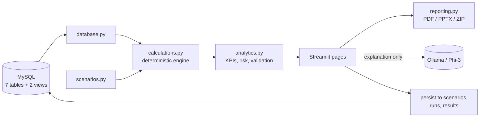

  

    <h1>NBE ALM Simulation Center</h1>
    
A what-if engine for Asset-Liability Management. Pick a scenario, see the impact on earnings, funding cost and liquidity, and read a management explanation, all computed by deterministic Python on the bank's own positions, cash flows and market data.

    Prototype &middot; Version 2.1.0 &middot; Engine v2
  

  

  
<b>9</b>scenario drivers

  
<b>15</b>KPIs compared

  
<b>7 + 2</b>tables + SQL views

  
<b>3</b>report formats

  
<b>0</b>numbers from the AI

!!! note "Prototype status"
    This is a prototype with an NBE-inspired visual theme. It is not an official National Bank of Egypt application, and the figures it produces are analytical proxies, not accounting or regulatory numbers.

## What it does

-   **Scenario → impact → insight**

    Choose a template, set up to nine drivers (policy rate, FX, gold, deposit run-off, loan and deposit growth, inflation, unemployment, GDP) and read the result on one dashboard.

-   **Event-based repricing engine**

    Interest is computed per position over the chosen horizon. A rate shock only bites after each position's first repricing date inside the window.

-   **P&L and value impact**

    NII change, macro credit cost, FX and gold revaluation, and investment mark-to-market are combined into one pre-tax proxy.

-   **Self-checking**

    An independent validation table recomputes NII, NIM, cost of funds, P&L and LCR from the position detail and reports PASS or FAIL.

-   **Local AI, explanation only**

    Phi-3 through Ollama explains the computed results and parses free-text scenarios. It never calculates a number.

-   **Reports**

    Download PDF, PowerPoint or a ZIP bundle, plus Excel with live formulas and CSV extracts.

## How the pieces fit

## Design principles

1. **Deterministic numbers.** Every figure comes from Python code and can be reproduced. The AI only explains.
2. **Existing database, no DDL.** The application reads and writes data rows. It never creates or alters tables.
3. **One consistent currency.** FX and gold positions are valued to EGP by the SQL views using the latest market rates, so every amount in the app is an EGP equivalent.
4. **Transparent assumptions.** Conventions, thresholds and coefficients are in `config.py` and explained in these pages, including what the model does *not* cover. See [Limitations](limitations.md).
5. **Graceful degradation.** If the database, Ollama or the reporting libraries are unavailable, the rest of the application keeps working and says what is missing.

## Technology

| Layer | Technology |
|---|---|
| UI | Streamlit, Plotly |
| Calculation | Python, pandas, NumPy |
| Database | MySQL 8, SQLAlchemy, PyMySQL |
| Reports | ReportLab (PDF), python-pptx (PPTX), openpyxl (Excel), Kaleido (chart images) |
| Local AI | Ollama with Phi-3 |

## Where to go next

| If you want to... | Read |
|---|---|
| Run it | [Getting Started](getting-started.md) |
| Understand every screen | [User Interface](ui.md) |
| See how a number is computed | [Calculation Engine](calculation-engine.md) |
| Understand the design | [Architecture](architecture.md) and [Design Decisions](decisions.md) |
| Know what to be careful about | [Limitations & Roadmap](limitations.md) |
| Prepare for questions | [FAQ](faq.md) |
