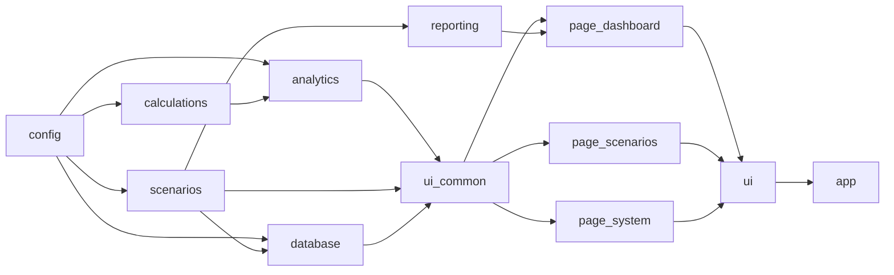

# Module Reference

Fourteen files, about 4,700 lines. Line counts are for v2.1.

| File | Lines | Role |
|---|---|---|
| `app.py` | 5 | Entry point, calls `run_app()` |
| `config.py` | 271 | Constants, parameters, templates, thresholds |
| `calculations.py` | 586 | Deterministic engine |
| `database.py` | 351 | Connection, loading, persistence |
| `scenarios.py` | 274 | Parameter handling, templates, Ollama |
| `analytics.py` | 809 | KPIs, risk, attribution, validation, Excel export |
| `ui.py` | 195 | Sidebar, data loading, routing |
| `ui_common.py` | 452 | Theme, cards, scenario runner, AI panel |
| `page_dashboard.py` | 558 | Dashboard and report builder |
| `page_scenarios.py` | 491 | Scenario creation, history, comparison |
| `page_system.py` | 97 | Data explorer, audit, settings |
| `reporting.py` | 379 | PDF, PPTX and ZIP |
| `page_documentation.py` | 193 | Old in-app documentation page, **not wired** |
| `Run_App.bat` | 4 | Windows launcher |

## `config.py`

| Group | Names |
|---|---|
| Identity | `APP_NAME`, `APP_VERSION` (2.1.0), `CALCULATION_ENGINE_VERSION` (2) |
| Conventions | `DAYS_PER_YEAR` 365, `RATE_FLOOR` 0, `DEFAULT_HORIZON_DAYS` 365 |
| Database | `DB_*`, `DB_POOL_PRE_PING`, `DB_POOL_RECYCLE` 1800, `DB_READ_LIMIT` 100000, `REQUIRED_TABLES`, view names |
| Market | `VALUATION_INSTRUMENTS`, `MACRO_CODES` |
| Behaviour flags | `FUNDING_SEGMENTS`, `EXCLUDE_MATURED_POSITIONS`, `ROLLOVER_AT_MATURITY` |
| Credit cost | `CREDIT_COST_BPS_PER_UNEMP_PP` 25, `CREDIT_COST_BPS_PER_GDP_DROP_PP` 20 |
| Frequencies | `TENOR_DAY_FACTORS`, `FREQUENCY_WORD_DAYS` |
| Liquidity | `LCR_WINDOW_DAYS` 30, `LCR_DEPOSIT_STRESS_FLOOR_PCT` 0.15, `MATURITY_BUCKET_ORDER` |
| Scenarios | `PARAM_SPECS`, `SCENARIO_DEFAULTS`, `SCENARIO_LIMITS`, `INDIVIDUAL_DRIVERS`, `SCENARIO_TEMPLATES`, `HORIZON_PRESETS` |
| Risk | `RISK_NII_HIGH_DROP_PCT`, `RISK_NII_MEDIUM_DROP_PCT`, `RISK_COF_MEDIUM_RISE_BPS`, `RISK_LCR_MEDIUM_RELATIVE_DROP_PCT`, `LCR_WARNING_THRESHOLD` |
| UI | colours, `DATA_CACHE_TTL_SECONDS`, `DOCS_BASE_URL` |

## `calculations.py`

| Function | Purpose |
|---|---|
| `tenor_to_days`, `normalize_market_yield` | Parsing helpers |
| `merge_params` | Fill missing drivers with defaults |
| `valuation_rates`, `macro_snapshot`, `market_history` | Read `market_data` |
| `position_category` | Loan, Deposit, Funding, Investment |
| `normalize_positions`, `normalize_cashflows` | Flat view to engine frame |
| `run_position_engine` | Per-position repricing, balances, interest, effects |
| `summarize_positions` | Before / After KPIs |
| `cashflow_metrics` | Liquidity and LCR proxy |
| `prepare_inputs` | Scenario-independent preparation |
| `apply_prepared` | Run a scenario on prepared inputs, return `before`, `after`, detail |
| `apply_scenario` | Convenience wrapper: prepare + apply |
| `build_model_baseline` | Baseline helper |

## `scenarios.py`

`scenario_summary`, `scenario_params_from_row`, `scenario_row_from_params`, `build_scenario_parameters`, `template_values`, `resolve_saved_template`, `individual_driver_to_params`, `params_to_individual_driver`, `build_saved_template_values`, `ollama_status`, `ask_ollama`, `clean_numeric_value`, `extract_parameters_regex`, `parse_free_type_scenario_with_ollama`.

## `analytics.py`

`fmt_amount`, `comparison_table`, `build_alm_risk_summary`, `shock_sensitivity`, `driver_attribution`, `position_sensitivity`, `pnl_components`, `overall_risk_rating`, `management_insights`, `liquidity_ladder`, `exposure_tables`, `build_data_quality_checks`, `calculation_validation_table`, `build_full_row_by_row_scenario_table`, `export_row_by_row_with_formulas_xlsx`.

## `ui_common.py`

| Function | Purpose |
|---|---|
| `show_df`, `style_nbe_figure` | Table and chart styling |
| `kpi_card`, `tone_for`, `risk_badge`, `active_driver_chips`, `render_page_header` | Visual components |
| `run_scenario` | Single entry point that evaluates a scenario and returns a result object |
| `current_session_scenario`, `evaluate_saved_scenario` | Result for the session scenario or a saved one |
| `cached_sensitivity`, `cached_attribution` | Cached heavy computations |
| `render_ai_scenario_panel` | AI explanation panel |

## `reporting.py`

`generate_pdf_report`, `generate_pptx_report`, `generate_zip_bundle`, `plotly_fig_to_png_bytes`, plus header and footer helpers. If `reportlab` or `python-pptx` is missing, `REPORTING_AVAILABLE` is false and the UI shows an install hint.

## Dependencies between modules

