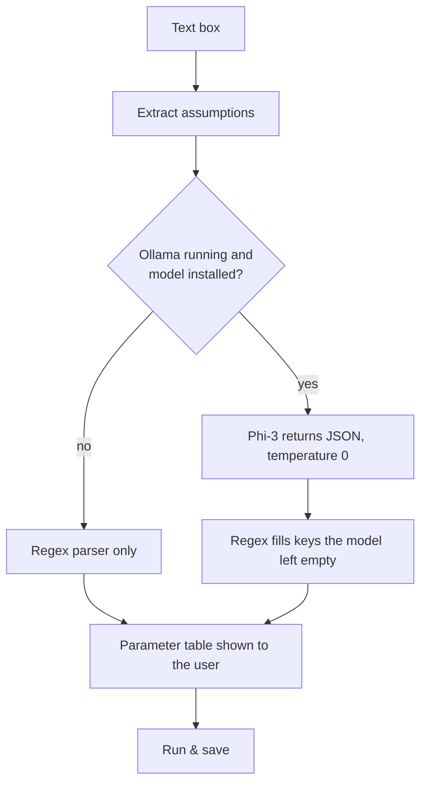
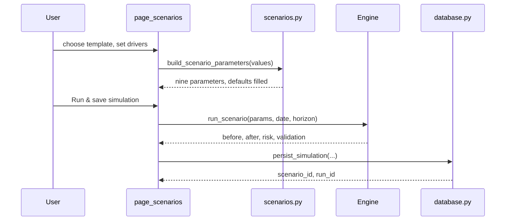

# Scenarios

A scenario is a set of up to **nine numeric drivers**, a simulation date and a horizon. The same nine drivers are the nine numeric columns of the `scenarios` table, so what you run is exactly what is saved.

## The nine drivers

Defined once in `PARAM_SPECS` (`config.py`). The UI, the database mapping, the reports and the free-text parser all read this table.

| Key | Label | Unit | Allowed range | Step | Group |
|---|---|---|---|---|---|
| `rate_change_pp` | Policy / market rate shock | pp | −1000 to 1000 | 0.25 | Market |
| `fx_shock_pct` | FX shock (USD/EGP & FCY) | % | −500 to 500 | 1 | Market |
| `gold_shock_pct` | Gold price shock | % | −500 to 500 | 1 | Market |
| `deposit_runoff_pct` | Deposit run-off (outflow) | % | 0 to 100 | 1 | Balance sheet & liquidity |
| `loan_growth_pct` | Loan growth | % | −100 to 100 | 1 | Balance sheet & liquidity |
| `deposit_growth_pct` | Deposit growth | % | 0 to 100 | 1 | Balance sheet & liquidity |
| `inflation_shock_pct` | Inflation shock | pp | −200 to 200 | 0.5 | Macro |
| `unemployment_shock_pct` | Unemployment shock | pp | −100 to 100 | 0.5 | Macro |
| `gdp_shock_pct` | GDP growth shock | pp | −200 to 200 | 0.5 | Macro |

All defaults are `0`, which is the base case. The UI clamps every input to its range.

!!! warning "Inflation has no KPI effect"
    `inflation_shock_pct` is stored, shown in the macro snapshot and passed to the AI, but no formula in the engine uses it. See [Limitations](limitations.md).

## Templates

| Template | `scenario_type` | Behaviour |
|---|---|---|
| **Base Case** | `BASE` | No assumptions. Before and after are equal. |
| **Combined Stress Scenario** | `COMBINED_STRESS` | All nine drivers are visible, grouped in three sections. Values start at zero. |
| **Individual Parameter Scenario** | `INDIVIDUAL_PARAMETER` | Choose one driver, set one value, all others stay neutral. |
| **Free Type Scenario** | `FREE_TYPE` | Describe the scenario in words. Numbers are extracted by Phi-3 or by regex. |

`resolve_saved_template` maps a saved row back to a template, and `build_saved_template_values` rebuilds the form values, so a saved scenario reopens in the same shape it was created in.

## Simulation window

| Setting | Default | Notes |
|---|---|---|
| Simulation date | today | The horizon is counted from this date. |
| Horizon | 365 days | 1 to 3650. Presets: 30, 90, 180, 365, 730. |
| Run mode | New Scenario | *Rerun Saved Scenario* loads a saved scenario's values into the form. |

## Unit conversions

| Where | Rule |
|---|---|
| Engine rate shock | `rate_change_pp / 100` is added to a decimal rate. +3 pp is +0.03. |
| Database | `policy_rate_shock_bps = rate_change_pp × 100`. A +3 pp shock is stored as 300. |
| Free text | `300 bps`, `+3%` and `3 pp` all become `rate_change_pp = 3`. |

## Free-text scenarios



Example input:

```text
Interest rates +300 bps; USD/EGP +15%; gold price -10%; deposit outflows 10%.
```

The regex parser understands English and Arabic keywords (for example `الدولار`, `الذهب`, `سحوبات`, `فائدة`), units `%`, `pp`, `bps`, and decrease words such as *drop*, *cut*, *انخفاض*. Deposit run-off is always stored as a positive number. The extracted values are shown in a table **before** anything runs, so the user can check them.

## From the screen to the database



Reruns of a saved scenario reuse its `scenario_id` and update the row, then add a new `simulation_runs` record.
