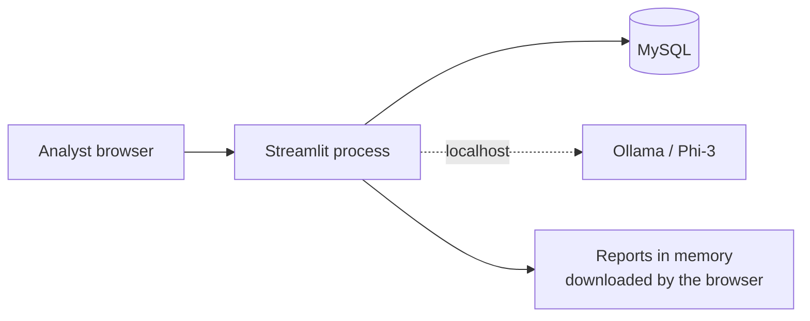

# Security & Data Handling

This is a prototype. The table below states what is protected, what is not, and what to change before production use.

## Data flow

No external API is called. The AI runs on the same machine, and reports are built in memory and handed to the browser.

## Status of controls

| Area | Status in v2.1 | Recommendation |
|---|---|---|
| **Authentication** | None. Anyone who can open the URL can run scenarios | Put the app behind the bank's SSO or reverse proxy |
| **Authorisation** | None | Roles for viewing, running and saving |
| **Audit** | Runs stored with `executed_by = "Streamlit"` | Record the real user |
| **DB account** | Defaults to `root` with an empty password | Dedicated account: `SELECT` on tables and views, `INSERT`/`UPDATE` on `scenarios`, `simulation_runs`, `simulation_results` only |
| **Secrets** | Environment variables, or typed into the settings tab and kept in `session_state` | Use a secrets manager; never commit credentials |
| **Password escaping** | Handled: connection built with `URL.create` | Keep |
| **Transport** | Streamlit serves plain HTTP | TLS at a reverse proxy |
| **SQL injection** | Reads and writes use SQLAlchemy parameters, but the AI panel and report builder build two queries by string and only double single quotes | Replace with bound parameters |
| **Writes** | Single transaction; DDL is never executed | Keep |
| **AI data egress** | None; Ollama is local | Keep it local, or get approval for any hosted model |
| **Error display** | The real MySQL error is shown in the connection tab | Hide details outside admin users |
| **HTML injection** | `unsafe_allow_html` is used for the logo and the CSS only, with fixed content | Keep user text out of those blocks |
| **Reports** | May contain balances and scenario results | Classify and store according to bank policy |

## Data classification

The application reads balances, rates and cash flows by position. Treat exports (Excel, CSV, PDF, PPTX) as confidential. They carry no password protection and no watermark in v2.1.

## Hardening checklist

1. Create a least-privilege MySQL user and set `DB_USER` and `DB_PASSWORD`.
2. Run behind HTTPS and authentication.
3. Change the default `DOCS_BASE_URL`.
4. Fix the string-built SQL.
5. Store the authenticated user in `executed_by`.
6. Restrict who can reach the Data explorer, which shows every table.
7. Add the license and disclosure text required for use of the NBE name and logo.
