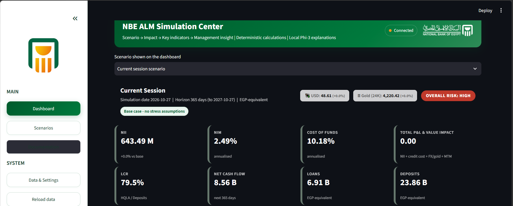

# User Interface

The application has three pages, reached from the sidebar. Every page is a function that receives the shared context built by `ui.py`.

| Sidebar item | Module | Purpose |
|---|---|---|
| **Dashboard** | `page_dashboard.py` | Results of the active scenario: KPIs, charts, tables, AI explanation, report export |
| **Scenarios** | `page_scenarios.py` | Create and run, browse saved scenarios, compare scenarios |
| **Data & Settings** | `page_system.py` | Data explorer, calculation audit, database and AI settings |
| **Documentation** | external link | Opens `DOCS_URL` in a new tab |
| **Reload data** | button | Clears the data cache and reruns |

## Dashboard

*Base case on the sample database: header banner, scenario selector, FX and gold chips, risk badge and the first KPI cards.*

The dashboard shows one scenario at a time. A selector at the top lets you switch between the scenario you just ran in this session and saved scenarios from the database (a saved scenario is re-evaluated on the fly with the current data).

### Header area

- **KPI cards:** NII, NIM, cost of funds, total P&L and value impact, LCR, net cash flow and the main balances, each with the change versus the base case. Colour tone follows whether higher is better for that metric.
- **Risk badge:** the overall rating (LOW, MEDIUM or HIGH) from `overall_risk_rating`. See [Analytics & Validation](analytics.md).
- **Driver chips:** the drivers that are non-zero in the active scenario.
- **Management insight:** short rule-based sentences from `management_insights`, produced without AI.

### Main tabs

| Tab | Content |
|---|---|
| **1. Overview** | NII bridge, P&L components chart, driver attribution table (standalone vs combined), KPI comparison table, AI explanation panel |
| **2. Balances** | Portfolio before vs after (loans, deposits, funding, investments) and balance by currency |
| **3. Liquidity** | Stressed maturity ladder: inflow, outflow and cumulative net by bucket |

### Advanced ALM analytics tables

Below the tabs, four more tabs give the detail behind the headline numbers.

| Tab | What it shows | Download |
|---|---|---|
| **Row-by-Row Details** | Every position with inputs, scenario parameters and isolated effects | Excel with live formulas |
| **Top Position Sensitivity** | The 10 positions with the largest total financial impact | CSV |
| **Liquidity Ladder** | Stressed cash flows by maturity bucket | CSV |
| **Exposure Breakdown** | Balances aggregated by category | CSV |

### Report builder

An expander, **Export Custom Executive Report**, lets you pick KPIs, charts, whether to include the comparison table and the AI or management text, and the format (PDF, PPTX or both). See [Reports & Exports](reports.md).

## Scenarios

Three tabs.

### Create & run

1. **Template:** Base Case, Combined Stress Scenario, Individual Parameter Scenario or Free Type Scenario.
2. **Simulation window:** simulation date, horizon in days (1 to 3650), run mode (*New Scenario* or *Rerun Saved Scenario*), and quick presets for 30, 90, 180, 365 and 730 days.
3. **Assumptions:** the nine drivers as number inputs, clamped to their allowed ranges. Individual mode shows one driver selector and one value. Free Type shows a text box and an **Extract assumptions** button.
4. **Run & save simulation.** The scenario is evaluated and written to the database in one transaction.

Details are in [Scenarios](scenarios.md).

### Saved scenarios

A table of all saved scenarios, and for the chosen one its stored assumptions with units.

### Compare scenarios

Select several saved scenarios. The page takes the latest run of each, pivots the KPI results by metric, and charts the amount KPIs side by side. Nothing is selected by default.

## Data & Settings

| Tab | Content |
|---|---|
| **Data explorer** | Browse any raw table or either flat view, with the row count |
| **Calculation audit** | The independent validation table with PASS or FAIL, and a summary banner |
| **Database connection** | Host, port, database, user, password and **Save and reconnect** |
| **AI (Ollama)** | Ollama URL and model name |

!!! note "Where the data-quality tab went"
    `_tab_quality` (row counts and data-quality checks) still exists in `page_system.py` but its tab is commented out in v2.1. The same validation is visible in the Calculation audit tab.

## Visual theme

`ui_common.py` holds one large CSS block that applies an NBE-inspired palette (green, dark green, orange), card styles for KPIs, the risk badge and section headers. `style_nbe_figure` applies the same palette to every Plotly chart so charts, tables and exports look consistent.
